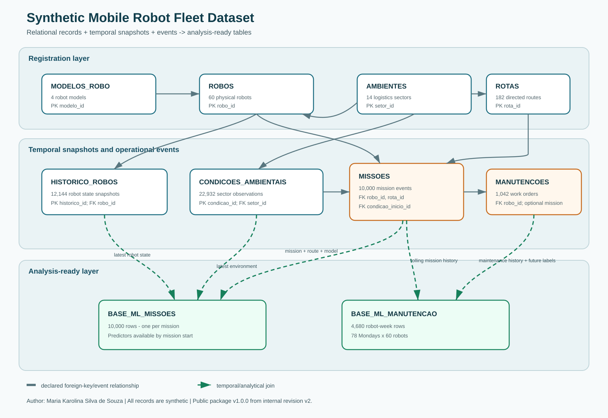

# Relational and temporal schema

**Author:** Maria Karolina Silva de Souza

This dataset combines stable registrations, temporal snapshots, operational events, and two analysis-ready tables. The diagram below summarizes the main relationships.

## Core relationships

| Parent | Child | Foreign key | Cardinality and interpretation |
| --- | --- | --- | --- |
| `MODELOS_ROBO` | `ROBOS` | `ROBOS.modelo_id` | One model can describe many physical robots. |
| `AMBIENTES` | `ROBOS` | `ROBOS.setor_base` | One sector can be the base sector of many robots. This is not the robot's instantaneous position. |
| `ROBOS` | `HISTORICO_ROBOS` | `HISTORICO_ROBOS.robo_id` | One robot has many dated state snapshots. |
| `AMBIENTES` | `CONDICOES_AMBIENTAIS` | `CONDICOES_AMBIENTAIS.setor_id` | One sector has observations at 00:00, 08:00, and 16:00. |
| `AMBIENTES` | `ROTAS` | `ROTAS.setor_origem_id` | A sector can be the origin of many directed routes. |
| `AMBIENTES` | `ROTAS` | `ROTAS.setor_destino_id` | A sector can be the destination of many directed routes. |
| `ROBOS` | `MISSOES` | `MISSOES.robo_id` | Each mission is performed by one robot. |
| `ROTAS` | `MISSOES` | `MISSOES.rota_id` | Each mission executes one directed route. |
| `CONDICOES_AMBIENTAIS` | `MISSOES` | `MISSOES.condicao_inicio_id` | Each mission references the latest available condition snapshot for the route destination at mission start. |
| `ROBOS` | `MANUTENCOES` | `MANUTENCOES.robo_id` | One robot can have many maintenance orders. |
| `MISSOES` | `MANUTENCOES` | `MANUTENCOES.missao_relacionada_id` | Optional. A corrective maintenance order can refer to the mission associated with the detected failure. |

## Temporal join rules

`BASE_ML_MISSOES` has one row per mission. Its predictor block is assembled using information available no later than `data_hora_inicio`:

- the mission's robot and stable model registration;
- the mission's directed route;
- the latest robot snapshot at or before mission start;
- the latest environmental snapshot for the route destination at or before mission start.

Outcome columns end in `_alvo`. They describe results observed during or after the mission and must not be used as predictors for a pre-mission model.

`BASE_ML_MANUTENCAO` has one row per robot per reference week. It uses the last state known at `data_referencia`, rolling historical windows, and future outcome columns describing the next seven days or the next maintenance event.

## Primary keys

| Table | Primary key |
| --- | --- |
| `MODELOS_ROBO` | `modelo_id` |
| `ROBOS` | `robo_id` |
| `HISTORICO_ROBOS` | `historico_id` |
| `AMBIENTES` | `setor_id` |
| `CONDICOES_AMBIENTAIS` | `condicao_id` |
| `ROTAS` | `rota_id` |
| `MISSOES` | `missao_id` |
| `MANUTENCOES` | `manutencao_id` |

The analytical tables use composite analytical units rather than new event identifiers: one `missao_id` per row in `BASE_ML_MISSOES`, and one `(data_referencia, robo_id)` pair per row in `BASE_ML_MANUTENCAO`.

## Integrity result

The local publication audit found zero unresolved declared foreign keys, zero duplicate or blank primary keys, zero mission/maintenance interval conflicts, and zero future-snapshot joins. See [VALIDATION.md](VALIDATION.md) for scope and limitations.
